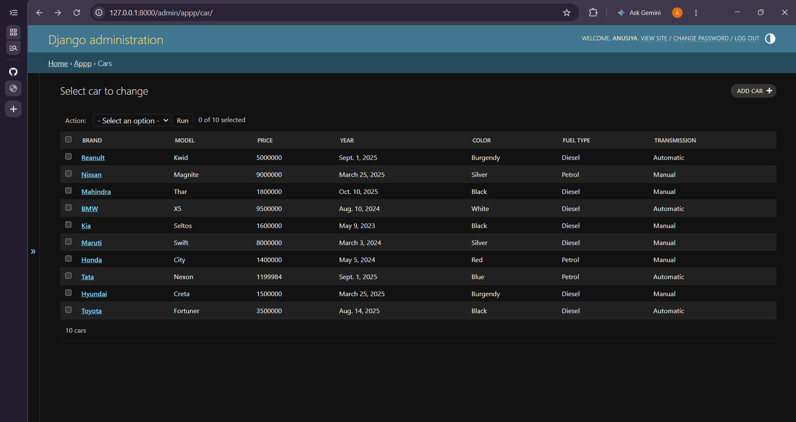

# Ex02 Django ORM Web Application
# Date: 21/11/2026
# AIM
To develop a Django application to store and retrieve data from a bank loan database using Object Relational Mapping(ORM).

# DESIGN STEPS
## STEP 1:
Clone the problem from GitHub

## STEP 2:
Create a new app in Django project

## STEP 3:
Enter the code for admin.py and models.py

## STEP 4:
Execute Django admin and create details for 10 cars

# PROGRAM

```
models.py 

from django.db import models
from django.contrib import admin

class Student(models.Model):
    Name=models.CharField(max_length=25)
    Age=models.IntegerField()
    DateofBirth=models.DateField()
    Father_Name=models.CharField(max_length=25)
    Mother_Name=models.CharField(max_length=25)
    Department=models.CharField(max_length=25)
    YearofStudy=models.IntegerField(null=True, blank=True)


class StudentAdmin(admin.ModelAdmin):
    list_display=['Name','Age','DateofBirth','Father_Name','Mother_Name','Department','YearofStudy']
```

```
admin.py 

from django.contrib import admin
from .models import Student, StudentAdmin

admin.site.register(Student,StudentAdmin)
```

```
urls.py

from django.contrib import admin
from django.urls import path
from appp import views

urlpatterns = [
    path('admin/', admin.site.urls),
    path('',views.home),
    path('about/',views.about),
]

```
# OUTPUT



# RESULT
Thus the program for creating a database using ORM hass been executed successfully
